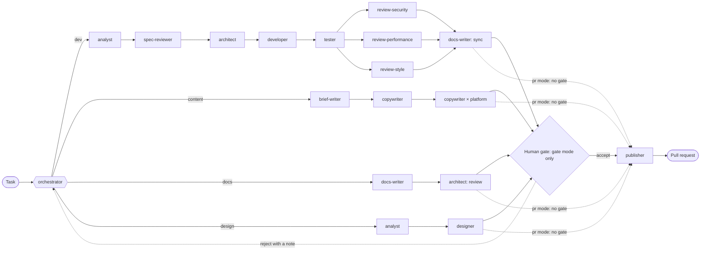

# Agent Factory

English | [Polski](README.pl.md)

A set of 14 agents and 15 general skills that work as one pipeline in
**Claude Code** and **GitHub Copilot**. One orchestrator plans and delegates,
specialized agents do the work, and a human reviews every change: at a gate
before the pull request, or in the pull request itself (the default).

Each agent is a single file that both tools load unchanged. The agents are
generic: checklists, formats and procedures come from the skills in this
repository, and knowledge about a specific project (stack, architecture,
design system) comes from skills kept in that project.

## The chain



An interactive version of this map, with every agent's role, tools and skills,
is in [docs/agent-chain.html](docs/agent-chain.html) (open it locally in a
browser).

## Pipelines

| Pipeline | When | Stages | Loops |
|---|---|---|---|
| **dev** | a code change | analyst → spec-reviewer → architect → developer → tester → three reviews in parallel → docs-writer (sync) → [gate] → publisher | spec unclear → analyst (`spec` ≤ 3); failing test or blocking finding → developer (`code` ≤ 3); environment error → 2 retries |
| **content** | text for an audience | brief-writer → copywriter → copywriter per platform (parallel) → [gate] → publisher | gate → author (`revision` ≤ 3) |
| **docs** | describing what exists | docs-writer → architect (review) → [gate] → publisher | architect → docs-writer (`revision` ≤ 3) |
| **design** | "design", mockup, UI/UX, redesign, `/design` | analyst → designer → [gate] → publisher | gate → designer or analyst (`revision` ≤ 3) |

`[gate]` applies in `gate` review mode only. By default (`pr` mode) the
publisher opens the pull request as soon as tests and reviews are clean and
the pull request is the review point; the orchestrator switches to `gate` for
changes that are hard to undo by closing a PR (owner agreements, deployment,
credentials, data migrations, cost, publishing outside a PR) or when you ask.
When a counter runs out, the run stops and waits for a human.

## Agents

| Agent | Role | Tools | Writes | Skills |
|---|---|---|---|---|
| `orchestrator` | classifies the task, delegates stages, counts attempts, keeps state and memory | all (inherited) | `runs/`, `memory/` | `task-classification`, `findings-merge`, `retrospective`, `factory`, `karpathy-guidelines`, `subagent-driven-development`, `dispatching-parallel-agents`, `requesting-code-review`, `mem-search` |
| `analyst` | requirements and testable acceptance criteria | Read, Grep, Glob, Write, Skill | its result file in `runs/` | `ac-format`, `karpathy-guidelines`, `brainstorming` |
| `spec-reviewer` | approves the spec or returns it with questions | Read, Grep, Glob, Write, Skill | its result file in `runs/` | `spec-checklist`, `karpathy-guidelines` |
| `architect` | technical design and plan; reviews docs against the code | Read, Grep, Glob, Write, Skill | its result file in `runs/` | `architecture-patterns`, `stack-and-style`, `karpathy-guidelines`, `writing-plans`, `ponytail` |
| `developer` | implements the plan test-first; the only agent that edits product code | Read, Grep, Glob, Edit, Write, Bash, Skill | code | `stack-and-style`, `ponytail`, `karpathy-guidelines`, `test-driven-development`, `systematic-debugging`, `receiving-code-review`, `security-checklist`, `verification-before-completion` |
| `tester` | checks every acceptance criterion with evidence | Read, Grep, Glob, Bash, Edit, Write, Skill | test files | `test-strategy`, `stack-and-style`, `test-driven-development`, `systematic-debugging`, `webapp-testing`, `verification-before-completion` |
| `review-security` | independent security review of the diff | Read, Grep, Glob, Skill | nothing | `security-checklist`, `stack-and-style` |
| `review-performance` | independent performance review of the diff | Read, Grep, Glob, Skill | nothing | `performance-checklist`, `stack-and-style` |
| `review-style` | conventions, readability, simplicity, scope | Read, Grep, Glob, Skill | nothing | `style-checklist`, `stack-and-style`, `ponytail-review` |
| `designer` | user flows, mockups, tokens, handoff | Read, Grep, Glob, Edit, Write, Skill | `runs/<id>/design/` | `design-system`, `brand-guidelines`, `frontend-design`, `web-artifacts-builder`, `canvas-design`, `theme-factory`, `ponytail` |
| `brief-writer` | content brief: goal, audience, message | Read, Grep, Glob, Skill | nothing | `brief-format`, `brand-guidelines`, `brainstorming` |
| `copywriter` | master text and per-platform adaptations | Read, Grep, Glob, Skill | nothing | `platform-rules`, `brand-guidelines`, `internal-comms`, `doc-coauthoring` |
| `docs-writer` | writes new docs; keeps docs in step with code changes | Read, Grep, Glob, Edit, Write, Skill | documentation | `docs-template`, `doc-coauthoring`, `stack-and-style` |
| `publisher` | branch, commit, pull request (in gate mode only after a recorded human accept) | Read, Grep, Glob, Bash, Skill | git | `commit-conventions`, `pr-template`, `finishing-a-development-branch` |

A missing skill never blocks an agent: it falls back to a default checklist in
its own file and reports the gap.

## Skills

**Included in this repository** (`skills/`, installed together with the
agents):

| Skill | What it gives | Used by |
|---|---|---|
| `task-classification` | choosing dev, content, docs or design; when to split or ask | orchestrator |
| `findings-merge` | one deduplicated list of review findings, blocking apart from warnings | orchestrator |
| `retrospective` | end-of-run review; candidates after three repetitions | orchestrator |
| `factory` | creating an agent or skill in the universal format | orchestrator |
| `ac-format` | acceptance criteria: one observable condition, an id, a way to verify | analyst |
| `spec-checklist` | ambiguity, testability, contradictions, scope, edge cases | spec-reviewer |
| `test-strategy` | test levels, mapping tests to criteria, classifying failures | tester |
| `security-checklist` | input, access control, secrets, exposure, dependencies | developer, review-security |
| `performance-checklist` | data access, cost, waiting, memory, caching, concurrency | review-performance |
| `style-checklist` | scope, simplicity, conventions, readability, tests, comments | review-style |
| `brief-format` | content brief template | brief-writer |
| `platform-rules` | adapting one text to different platforms | copywriter |
| `docs-template` | document types, sections, keeping docs in step with code | docs-writer |
| `commit-conventions` | commit messages and branch names | publisher |
| `pr-template` | pull request title and description | publisher |

**Kept in each project's own repository**, because they describe that
project: `stack-and-style`, `architecture-patterns`, `design-system`. A
project skill with the same name as a general one takes precedence in that
project.

**External, installed as plugins** (not copied here):

| Source | Skills | Used by |
|---|---|---|
| [Karpathy guidelines](https://github.com/multica-ai/andrej-karpathy-skills) | `karpathy-guidelines` | orchestrator, analyst, spec-reviewer, architect, developer |
| [Superpowers](https://github.com/obra/superpowers) | `subagent-driven-development`, `dispatching-parallel-agents`, `requesting-code-review` | orchestrator |
| | `brainstorming` | analyst, brief-writer |
| | `writing-plans` | architect |
| | `test-driven-development`, `systematic-debugging` | developer, tester |
| | `receiving-code-review` | developer |
| | `verification-before-completion` | developer, tester |
| | `finishing-a-development-branch` | publisher |
| [Ponytail](https://github.com/DietrichGebert/ponytail) | `ponytail`, `ponytail-review` | architect, developer, designer, review-style |
| [Anthropic skills](https://github.com/anthropics/skills) | `frontend-design`, `canvas-design`, `web-artifacts-builder`, `theme-factory`, `brand-guidelines`, `doc-coauthoring`, `internal-comms`, `webapp-testing` | designer, brief-writer, copywriter, docs-writer, tester |
| [claude-mem](https://github.com/thedotmack/claude-mem) | `mem-search` | orchestrator |

Install commands are in
[docs/ORCHESTRATION.md](docs/ORCHESTRATION.md#8-installation-and-keeping-in-sync).

## Shared parts

| Part | What it does |
|---|---|
| **State** | `runs/<run-id>/state.json` is the single source of truth. Only the orchestrator writes it. |
| **Review mode** | `pr` (default): the pull request is the review point. `gate`: the run stops before publication; accept, reject with a note, or ask for a minor change. |
| **Talking to the owner** | Short messages, at most 3 merged questions with a recommended default, and a `Waiting for you` block for every unanswered question. |
| **Memory** | After every run the orchestrator writes what was learned to `memory/runs/<run-id>.md` and reads matching records at the next start. [claude-mem](https://github.com/thedotmack/claude-mem) adds search across sessions. Agents also share long-term memory through the [Mem0](https://mem0.ai) MCP server (`mcp__mem0__*`, no delete). |
| **Fresh branch** | Before the first stage that edits files, the orchestrator fetches, fast-forwards the default branch and creates the run's branch from it. |
| **Docs move with the change** | Before the gate, `docs-writer` updates the documents a code change makes outdated. They ship in the same pull request. |
| **Observation** | [Claude Code Agent Monitor](https://github.com/hoangsonww/Claude-Code-Agent-Monitor) shows the run tree; every dispatch is named `[run-id] agent #attempt`. |
| **Working rules** | [Karpathy guidelines](https://github.com/multica-ai/andrej-karpathy-skills) for the orchestrator, [Ponytail](https://github.com/DietrichGebert/ponytail) for the smallest complete change, the [Superpowers](https://github.com/obra/superpowers) contract between agents. |

## Quick start

Install the agents and skills for every project (copies them to
`~/.claude/{agents,skills}/` and `~/.copilot/{agents,skills}/`):

```bash
git clone https://github.com/luk98j/agent-factory.git && cd agent-factory
scripts/install.sh
```

Start a session with the orchestrator as the main agent, inside the project
you want to work on:

```bash
claude --agent orchestrator
```

```bash
copilot --agent orchestrator
```

Then describe the task in plain language. The orchestrator picks the
pipeline:

- "Add e-mail validation to the sign-up form" → dev
- "Design the login screen" or `/design login screen` → design
- "Describe how the payments module works" → docs
- "Write a LinkedIn post about the new feature" → content

In `pr` mode (the default) the orchestrator opens the pull request itself when
tests and reviews are clean, and you review it there. In `gate` mode the run
stops with a report and the pull request is opened only after you accept. The publisher needs a git repository with a remote and an
authenticated `gh`.

## Keeping the repository and your agents in sync

| Direction | Command | What it does |
|---|---|---|
| repository → user folders | `scripts/install.sh` | copies `agents/*.agent.md` and `skills/<name>/`; touches nothing else in the targets |
| user folder → repository | `scripts/sync-back.sh` | creates the branch `sync/<timestamp>` and commits the agents and skills that changed |

Useful options:

- `scripts/install.sh --dry-run` shows what would change.
- `scripts/sync-back.sh --push` also pushes the branch and opens a pull request
  with `gh`.
- `scripts/sync-back.sh --from copilot` reads from the Copilot folder instead
  of the Claude one.
- `scripts/sync-back.sh --add my-agent` brings in an agent the repository does
  not track yet; `--add-skill my-skill` does the same for a skill folder.

Before committing, `sync-back.sh` scans the changed files for home paths,
e-mail addresses and credential formats, and stops if it finds any.

The scripts are Bash and run on macOS, Linux, WSL and Git Bash. Override the
target folders with `CLAUDE_HOME_DIR` and `COPILOT_HOME_DIR`.

## Documentation

- [docs/ORCHESTRATION.md](docs/ORCHESTRATION.md): the full description:
  format, contract between agents, loops, state, memory, skills, dependencies,
  known limits.
- [docs/agent-chain.html](docs/agent-chain.html): the interactive map.

## Status

The agent definitions pass `claude plugin validate`. The format follows the
Claude Code and GitHub Copilot documentation; a full run in each tool is still
to be verified. Known limits are listed in
[docs/ORCHESTRATION.md](docs/ORCHESTRATION.md#9-limits-and-things-to-verify).

## License

[Apache License 2.0](LICENSE).
