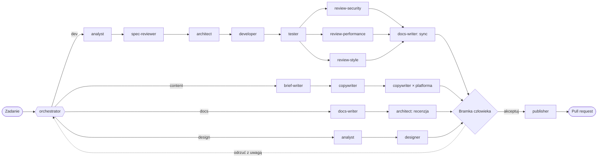

# Agent Factory

[English](README.md) | Polski

Zestaw 14 agentów działających jako jeden pipeline w **Claude Code** i
**GitHub Copilot**. Jeden orchestrator planuje i deleguje, wyspecjalizowani
agenci wykonują pracę, a nic nie jest publikowane bez akceptacji człowieka.

Każdy agent to jeden plik, który oba narzędzia ładują bez zmian. Agenci są
generyczni: wiedza o projekcie (stack, konwencje, checklisty) pochodzi ze
skilli.

## Łańcuch



Interaktywna wersja tej mapy, z rolą, narzędziami i skillami każdego agenta,
jest w [docs/agent-chain.html](docs/agent-chain.html) (otwórz lokalnie w
przeglądarce, przełącznik PL w prawym górnym rogu).

## Pipeline'y

| Pipeline | Kiedy | Etapy | Pętle |
|---|---|---|---|
| **dev** | zmiana kodu | analyst → spec-reviewer → architect → developer → tester → trzy przeglądy równolegle → docs-writer (sync) → bramka → publisher | spec niejasna → analyst (`spec` ≤ 3); błąd testu lub ustalenie blokujące → developer (`code` ≤ 3); błąd środowiska → 2 ponowienia |
| **content** | tekst dla odbiorców | brief-writer → copywriter → copywriter per platforma (równolegle) → bramka → publisher | bramka → autor (`revision` ≤ 3) |
| **docs** | opis istniejącego | docs-writer → architect (recenzja) → bramka → publisher | architect → docs-writer (`revision` ≤ 3) |
| **design** | „design", makieta, UI/UX, redesign, `/design` | analyst → designer → bramka → publisher | bramka → designer lub analyst (`revision` ≤ 3) |

Po wyczerpaniu licznika przebieg zatrzymuje się i czeka na człowieka.

## Agenci

| Agent | Rola | Narzędzia | Zapisuje | Skille |
|---|---|---|---|---|
| `orchestrator` | klasyfikuje zadanie, deleguje etapy, liczy próby, prowadzi stan i pamięć | wszystkie (dziedziczone) | `runs/`, `memory/` | `task-classification`, `findings-merge`, `retrospective`, `factory`, `karpathy-guidelines`, `dispatching-parallel-agents`, `mem-search` |
| `analyst` | wymagania i testowalne kryteria akceptacji | Read, Grep, Glob, Skill | nic | `ac-format`, `brainstorming` |
| `spec-reviewer` | zatwierdza spec albo zwraca z pytaniami | Read, Grep, Glob, Skill | nic | `spec-checklist` |
| `architect` | projekt techniczny i plan; recenzja dokumentacji względem kodu | Read, Grep, Glob, Skill | nic | `architecture-patterns`, `stack-and-style`, `writing-plans`, `ponytail` |
| `developer` | implementuje plan test-first; jedyny agent edytujący kod produktu | Read, Grep, Glob, Edit, Write, Bash, Skill | kod | `stack-and-style`, `ponytail`, `test-driven-development`, `systematic-debugging`, `security-checklist`, `verification-before-completion` |
| `tester` | sprawdza każde kryterium akceptacji z dowodem | Read, Grep, Glob, Bash, Edit, Write, Skill | pliki testów | `test-strategy`, `stack-and-style`, `webapp-testing`, `verification-before-completion` |
| `review-security` | niezależny przegląd bezpieczeństwa diffu | Read, Grep, Glob, Skill | nic | `security-checklist`, `stack-and-style` |
| `review-performance` | niezależny przegląd wydajności diffu | Read, Grep, Glob, Skill | nic | `performance-checklist`, `stack-and-style` |
| `review-style` | konwencje, czytelność, prostota, zakres | Read, Grep, Glob, Skill | nic | `style-checklist`, `stack-and-style`, `ponytail-review` |
| `designer` | flow użytkownika, makiety, tokeny, handoff | Read, Grep, Glob, Edit, Write, Skill | `runs/<id>/design/` | `design-system`, `brand-guidelines`, `frontend-design`, `web-artifacts-builder`, `canvas-design`, `theme-factory`, `ponytail` |
| `brief-writer` | brief: cel, odbiorca, przekaz | Read, Grep, Glob, Skill | nic | `brief-format`, `brand-guidelines`, `brainstorming` |
| `copywriter` | tekst główny i adaptacje per platforma | Read, Grep, Glob, Skill | nic | `platform-rules`, `brand-guidelines`, `internal-comms`, `doc-coauthoring` |
| `docs-writer` | pisze nową dokumentację; utrzymuje ją zgodną ze zmianami kodu | Read, Grep, Glob, Edit, Write, Skill | dokumentacja | `docs-template`, `doc-coauthoring`, `stack-and-style` |
| `publisher` | gałąź, commit, pull request, tylko po zapisanej akceptacji człowieka | Read, Grep, Glob, Bash, Skill | git | `commit-conventions`, `pr-template`, `finishing-a-development-branch` |

Brak skilla nigdy nie blokuje agenta: używa on domyślnej checklisty ze swojego
pliku i zgłasza brak.

## Elementy wspólne

| Element | Co robi |
|---|---|
| **Stan** | `runs/<run-id>/state.json` to jedyne źródło prawdy. Zapisuje tylko orchestrator. |
| **Bramka człowieka** | Każdy pipeline zatrzymuje się przed publikacją. Akceptuj, odrzuć z uwagą albo poproś o drobną zmianę. |
| **Pamięć** | Po każdym przebiegu orchestrator zapisuje wnioski do `memory/runs/<run-id>.md` i czyta pasujące zapisy przy kolejnym starcie. [claude-mem](https://github.com/thedotmack/claude-mem) dodaje wyszukiwanie między sesjami. |
| **Dokumentacja idzie ze zmianą** | Przed bramką `docs-writer` aktualizuje dokumenty, które zmiana kodu czyni nieaktualnymi. Trafiają do tego samego pull requesta. |
| **Podgląd** | [Claude Code Agent Monitor](https://github.com/hoangsonww/Claude-Code-Agent-Monitor) pokazuje drzewo przebiegu; każde wywołanie ma nazwę `[run-id] agent #próba`. |
| **Zasady pracy** | [Zasady Karpathy'ego](https://github.com/multica-ai/andrej-karpathy-skills) u orchestratora, [Ponytail](https://github.com/DietrichGebert/ponytail) dla najmniejszej kompletnej zmiany, kontrakt między agentami z [Superpowers](https://github.com/obra/superpowers). |

## Szybki start

Instalacja agentów dla wszystkich projektów (kopiuje je do `~/.claude/agents/`
i `~/.copilot/agents/`):

```bash
git clone https://github.com/luk98j/agent-factory.git && cd agent-factory
scripts/install.sh
```

Uruchom sesję z orchestratorem jako głównym agentem, w projekcie, nad którym
chcesz pracować:

```bash
claude --agent orchestrator
```

```bash
copilot --agent orchestrator
```

Potem opisz zadanie zwykłym językiem. Orchestrator wybierze pipeline:

- „Dodaj walidację e-maila w formularzu rejestracji" → dev
- „Zaprojektuj ekran logowania" albo `/design ekran logowania` → design
- „Opisz, jak działa moduł płatności" → docs
- „Napisz post na LinkedIn o nowej funkcji" → content

Przebieg zatrzyma się na bramce z raportem. Pull request powstaje dopiero po
akceptacji. Publisher wymaga repozytorium git z remote i zalogowanego `gh`.

## Synchronizacja repozytorium z Twoimi agentami

| Kierunek | Komenda | Co robi |
|---|---|---|
| repozytorium → foldery użytkownika | `scripts/install.sh` | kopiuje `agents/*.agent.md`; niczego innego w folderach docelowych nie rusza |
| folder użytkownika → repozytorium | `scripts/sync-back.sh` | tworzy gałąź `sync/agents-<znacznik-czasu>` i commituje zmienionych agentów |

Przydatne opcje:

- `scripts/install.sh --dry-run` pokazuje, co by się zmieniło.
- `scripts/sync-back.sh --push` dodatkowo wypycha gałąź i otwiera pull request
  przez `gh`.
- `scripts/sync-back.sh --from copilot` czyta z folderu Copilota zamiast
  Claude.
- `scripts/sync-back.sh --add moj-agent` dodaje agenta, którego repozytorium
  jeszcze nie śledzi.

Przed commitem `sync-back.sh` skanuje zmienione pliki pod kątem ścieżek
domowych, adresów e-mail i formatów kluczy; jeśli coś znajdzie, zatrzymuje się.

Skrypty są w Bashu i działają na macOS, Linuksie, WSL i Git Bash. Foldery
docelowe można nadpisać zmiennymi `CLAUDE_AGENTS_DIR` i `COPILOT_AGENTS_DIR`.

## Dokumentacja

- [docs/ORCHESTRATION.pl.md](docs/ORCHESTRATION.pl.md): pełny opis: format,
  kontrakt między agentami, pętle, stan, pamięć, skille, zależności, znane
  ograniczenia.
- [docs/agent-chain.html](docs/agent-chain.html): interaktywna mapa.

## Status

Definicje agentów przechodzą `claude plugin validate`. Format jest zgodny z
dokumentacją Claude Code i GitHub Copilot; pełny przebieg w każdym z narzędzi
wymaga jeszcze weryfikacji. Znane ograniczenia są w
[docs/ORCHESTRATION.pl.md](docs/ORCHESTRATION.pl.md#9-ograniczenia-i-rzeczy-do-sprawdzenia).

## Licencja

[Apache License 2.0](LICENSE).
