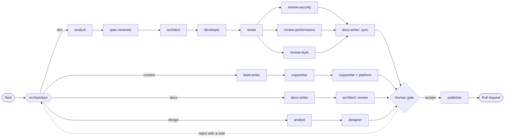
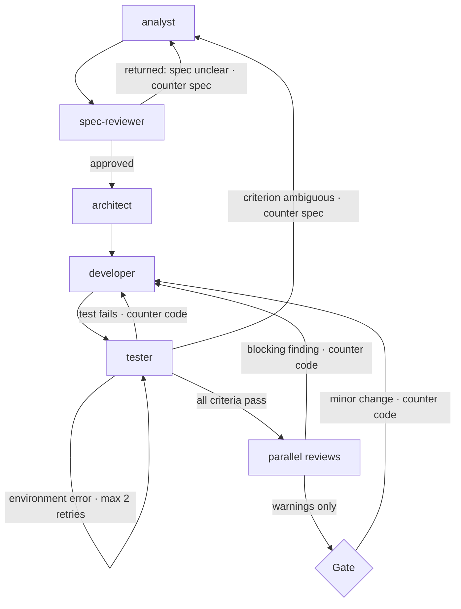

# Agent orchestration: stack documentation

English | [Polski](ORCHESTRATION.pl.md)

How the 14 agents in `agents/` connect, which skills they use, and how memory,
Ponytail, the Karpathy guidelines and the monitor fit in. Visual version:
[agent-chain.html](agent-chain.html).

## 1. Agents

| Agent | Pipeline | Role | Tools | Writes |
|---|---|---|---|---|
| `orchestrator` | all | classifies, plans, delegates, counts attempts, keeps state and memory, stops at the gate | all (inherited) | `runs/` and `memory/` only |
| `analyst` | dev, design | requirements and acceptance criteria | Read, Grep, Glob, Skill | nothing |
| `spec-reviewer` | dev | approves the spec or returns it with questions | Read, Grep, Glob, Skill | nothing |
| `architect` | dev, docs | technical design and plan; documentation review | Read, Grep, Glob, Skill | nothing |
| `developer` | dev | code, test-first; fixes | Read, Grep, Glob, Edit, Write, Bash, Skill | code |
| `tester` | dev | verification per acceptance criterion, with evidence | Read, Grep, Glob, Bash, Edit, Write, Skill | test files only |
| `review-security` | dev | security review | Read, Grep, Glob, Skill | nothing |
| `review-performance` | dev | performance review | Read, Grep, Glob, Skill | nothing |
| `review-style` | dev | conventions, simplicity, scope | Read, Grep, Glob, Skill | nothing |
| `designer` | design | flows, mockups, tokens, handoff | Read, Grep, Glob, Edit, Write, Skill | `runs/<id>/design/` only |
| `brief-writer` | content | brief: goal, audience, message | Read, Grep, Glob, Skill | nothing |
| `copywriter` | content | master text and per-platform adaptations | Read, Grep, Glob, Skill | nothing |
| `docs-writer` | docs, dev | new document (docs); documentation update after a change (dev, `sync` mode) | Read, Grep, Glob, Edit, Write, Skill | documentation only |
| `publisher` | all | branch, commit, pull request after acceptance | Read, Grep, Glob, Bash, Skill | git |

## 2. Universal format

One file per agent, the same content for both tools: `<name>.agent.md`.

```yaml
---
name: review-security
description: one sentence saying when to use it
tools: [Read, Grep, Glob, Skill]
---
```

Why one file works in both:

- **The `.agent.md` extension** ends in `.md`, so Claude Code loads it from
  `.claude/agents/` and Copilot from `.github/agents/`. Copilot CLI also reads
  `.claude/agents/`.
- **Claude tool names** (`Read`, `Grep`, `Glob`, `Edit`, `Write`, `Bash`) are
  official Copilot aliases for `read`, `search`, `edit`, `execute`. Copilot
  ignores names it does not recognize.
- **No `model` field.** The agent inherits the session model in both tools.
  Model identifiers differ between hosts, so naming one would break the other.
  To put reviewers on a cheaper model, add a single string per host (Copilot
  CLI rejects an array in `model`).
- **Shared fields only.** No `skills`, `hooks`, `handoffs` or `mcp-servers`.
  Skills are named in the agent body, not in the frontmatter.
- **The orchestrator has no `tools` list**, because it needs memory (MCP) and
  delegation tools whose names differ between hosts. Its limits come from its
  instructions: it does not write code and does not publish.

Where the files go:

| Host | Folder | Start |
|---|---|---|
| Claude Code | `~/.claude/agents/` or `.claude/agents/` | `claude --agent orchestrator` |
| Copilot CLI | `~/.copilot/agents/`, `.github/agents/` or `.claude/agents/` | `copilot --agent orchestrator` |
| Copilot in VS Code | `.github/agents/` | pick `orchestrator` in the agent picker |

`scripts/install.sh` copies the agents to the two user-level folders; see
section 8.

## 3. Pipelines



| Pipeline | When | Stages |
|---|---|---|
| dev | a code change | analyst → spec-reviewer → architect → developer → tester → 3 reviews in parallel → docs-writer (sync) → gate → publisher |
| content | text for an audience | brief-writer → copywriter → copywriter per platform (parallel) → gate → publisher |
| docs | describing what exists | docs-writer → architect (review) → gate → publisher |
| design | "design", mockup, wireframe, UI/UX, redesign, `/design` | analyst → designer → gate → publisher |

An accepted design does not start a dev run on its own. The orchestrator
offers it at the gate and starts a new run only after you agree, with the
design as input.

### Documentation moves with the change

A change does not reach the gate while the documentation still describes the
old behavior. In the dev pipeline, once tests and reviews are clean, the
orchestrator dispatches `docs-writer` in `sync` mode with the diff and the
spec. The agent looks for the places the change makes outdated (README files,
the docs folder, architecture notes, diagrams, changelog) and updates only
those. If nothing needs to change it answers `DOCS_AFFECTED: none` with the
places it searched.

The updated documents go into the same pull request as the code, and the gate
report lists them. When a later fix changes the code again, the sync runs
again. The same rule covers the orchestration itself: when `factory` adds or
changes an agent, a skill or a pipeline, this document and the map are updated
in the same run.

### Loops in the dev pipeline



| What happened | Goes back to | Counter |
|---|---|---|
| Spec unclear | analyst | `spec`, max 3 |
| A test fails | developer | `code`, max 3 |
| Blocking review finding | developer | `code`, max 3 |
| Review warning | gate report | none |
| Environment error | retry the step | no counter, max 2 |
| Rework of content, docs or design | the authoring agent | `revision`, max 3 |

When a counter is exhausted the stage becomes `waiting_human` and the
orchestrator reports: the goal, what was done, the outcome of every attempt,
the last state, the open question.

## 4. Contract between agents

Modeled on Superpowers (subagent-driven development):

- **The brief** from the orchestrator is the agent's whole context: run id,
  stage, attempt number, the goal and how it is verified, input paths,
  acceptance criteria, what is out of scope.
- **A status** in the final message: `DONE`, `DONE_WITH_CONCERNS`,
  `NEEDS_CONTEXT`, `BLOCKED`. `NEEDS_CONTEXT` does not use up an attempt.
- **A report is a claim, not proof.** The orchestrator and the tester check
  the evidence (test output, diff) before a stage is marked `ok`.
- **Worker agents do not delegate.** Only the orchestrator dispatches agents.
- **Reviewers are independent:** they get the diff, the spec and the
  acceptance criteria, never the developer's report or reasoning. They are
  read-only; the developer makes the fixes.
- **`ERROR_CLASS`** (`implementation`, `spec_unclear`, `environment`) decides
  where the run goes next.

## 5. State and gate

`runs/<run-id>/state.json` is the single source of truth. Only the
orchestrator writes it; stage results go to `runs/<run-id>/<stage>.md`.

```json
{
  "run_id": "2026-11-12-001",
  "task": { "type": "dev | content | docs | design", "brief": "…" },
  "acceptance_criteria": [ { "id": "AC-1", "text": "…", "status": "pending | pass | fail" } ],
  "stages": [ { "id": "…", "agent": "…", "status": "pending | in_progress | ok | error | waiting_human",
                "attempt": 1, "max_attempts": 3, "started_at": "…", "finished_at": "…", "result_ref": "…" } ],
  "counters": { "spec": 0, "code": 0, "revision": 0 },
  "findings": [ { "source": "…", "severity": "blocking | warning", "text": "…" } ],
  "decisions": [ { "at": "…", "by": "human | orchestrator", "text": "…" } ],
  "trace": [ { "at": "…", "stage": "…", "event": "…", "cost_tokens": 0 } ]
}
```

The gate comes before publication in every pipeline:

| Decision | Effect |
|---|---|
| Accept | an entry in `decisions` (`by: human`), then the publisher |
| Reject with a note | the orchestrator picks the stage and re-dispatches |
| Minor change | back to the author on the `code` or `revision` counter |

The publisher reads `state.json` itself and returns `BLOCKED` without an
acceptance entry. It never pushes to the default branch, never force-pushes
and never merges the pull request.

## 6. Skills

An agent loads a skill when it matches the step. When the skill is not
installed, the agent uses the default checklist written in its own file and
reports the gap in `SKILLS_MISSING`. This keeps the agents generic: knowledge
about a project (stack, conventions) lives in skills.

**Project skills (yours to write):**

| Skill | Used by |
|---|---|
| `task-classification`, `findings-merge`, `retrospective`, `factory` | orchestrator |
| `ac-format` | analyst |
| `spec-checklist` | spec-reviewer |
| `architecture-patterns` | architect |
| `stack-and-style` | architect, developer, tester, reviewers, docs-writer |
| `test-strategy` | tester |
| `security-checklist` | developer, review-security |
| `performance-checklist` | review-performance |
| `style-checklist` | review-style |
| `brief-format` | brief-writer |
| `platform-rules` | copywriter |
| `docs-template` | docs-writer |
| `design-system` | designer |
| `commit-conventions`, `pr-template` | publisher |

**External skills:**

| Source | Skills | Used by |
|---|---|---|
| [multica-ai/andrej-karpathy-skills](https://github.com/multica-ai/andrej-karpathy-skills) | `karpathy-guidelines` | orchestrator |
| [obra/superpowers](https://github.com/obra/superpowers) | `brainstorming` | analyst, brief-writer |
| | `writing-plans` | architect |
| | `test-driven-development`, `systematic-debugging` | developer |
| | `verification-before-completion` | developer, tester |
| | `dispatching-parallel-agents` | orchestrator |
| | `finishing-a-development-branch` | publisher |
| [anthropics/skills](https://github.com/anthropics/skills) | `frontend-design`, `web-artifacts-builder`, `canvas-design`, `theme-factory`, `brand-guidelines` | designer |
| | `brand-guidelines` | brief-writer, copywriter |
| | `internal-comms`, `doc-coauthoring` | copywriter, docs-writer |
| | `webapp-testing` | tester |
| [DietrichGebert/ponytail](https://github.com/DietrichGebert/ponytail) | `ponytail` | architect, developer, designer |
| | `ponytail-review` | review-style |
| [thedotmack/claude-mem](https://github.com/thedotmack/claude-mem) | `mem-search` | orchestrator |

## 7. What comes from where

**Karpathy guidelines (orchestrator).** The four rules, moved to the level of
delegation: think before delegating (state assumptions, ask one question
instead of choosing silently), the shortest pipeline, surgical scope in every
brief, a verifiable goal instead of an instruction.

**Superpowers.** The contract in section 4, test-first for the developer,
evidence before a verdict for the tester, a plan in small tasks for the
architect.

**Ponytail.** The "smallest complete change" ladder for the developer, the
architect and the designer: does it need to exist, is it already in the
codebase, the standard library, an installed dependency, one line, and only
then new code. It never cuts validation, error handling, security or
accessibility. Shortcuts are marked with a `shortcut:` comment and listed in
the pull request. `review-style` uses `ponytail-review`.

**Memory: a record after every run.** Memory has two layers, and only the
orchestrator writes to it.

The file layer works on every host. After every run (published, rejected or
escalated) the orchestrator writes `memory/runs/<run-id>.md` and adds a line
to `memory/INDEX.md`. The record is under a page: the request and the outcome,
decisions with their reasons (including yours at the gate), what looped and
what finally worked, rejected approaches, project conventions learned, missing
skills and retrospective candidates. It holds what was learned, not a log; the
log is in `state.json`. At the start of the next run the orchestrator reads
the index and opens only the matching records. Memory files are not part of
the run's pull request.

**claude-mem (searchable memory, when installed).**

| Moment | Action |
|---|---|
| run start | recall in three steps: `search` → `timeline` → `get_observations`; earlier decisions, rejected approaches, gate feedback, recurring findings |
| during the run | only a few relevant lines go into briefs; nothing from the developer's reasoning reaches reviewers |
| gate, escalation, end | a deliberate note (`save_memory`): the human decision with its reason, why a loop escalated, retrospective candidates |

Memory is advisory: `state.json` and the current request win. A run does not
stop when memory is unavailable. The retrospective uses memory to count
"three repetitions" across runs.

**Claude Code Agent Monitor (observation).** It works through host hooks, so
it needs nothing from the agents except readable runs: the orchestrator always
delegates to named agents and names every dispatch
`[<run-id>] <agent> #<attempt>`. The monitor shows the orchestrator → agents
tree, tools, tokens and cost.

## 8. Installation and keeping in sync

Install the agents for every project:

```bash
scripts/install.sh
```

It copies `agents/*.agent.md` to `~/.claude/agents/` and `~/.copilot/agents/`
and touches nothing else there. `--dry-run` shows what would change.

Bring changes made in the user folder back into the repository:

```bash
scripts/sync-back.sh
```

It compares the user folder with `agents/`, creates the branch
`sync/agents-<timestamp>`, and commits the agents that changed. `--push` also
pushes and opens a pull request. Before committing it scans the changed files
for home paths, e-mail addresses and credential formats, and stops if it finds
any. Run it from an up-to-date default branch.

Dependencies, in Claude Code:

```
/plugin marketplace add forrestchang/andrej-karpathy-skills
/plugin install andrej-karpathy-skills@karpathy-skills
/plugin install superpowers@claude-plugins-official
/plugin marketplace add anthropics/skills
/plugin install example-skills@anthropic-agent-skills
/plugin marketplace add DietrichGebert/ponytail
/plugin install ponytail@ponytail
```

In Copilot CLI:

```
copilot plugin marketplace add obra/superpowers-marketplace
copilot plugin install superpowers@superpowers-marketplace
copilot plugin marketplace add DietrichGebert/ponytail
copilot plugin install ponytail@ponytail
```

Memory and monitor:

```
npx claude-mem install
git clone https://github.com/hoangsonww/Claude-Code-Agent-Monitor.git
cd Claude-Code-Agent-Monitor && npm run setup && npm run dev
```

The monitor runs at `http://localhost:5173` and offers to install its hooks on
first launch.

## 9. Limits and things to verify

- **The monitor does not support Copilot.** Its README lists Claude Code,
  Cursor and Codex. Runs in Copilot will not appear in it.
- **The monitor is not the gate.** It shows sessions; it does not read
  `state.json`. You give your decision to the orchestrator in the
  conversation.
- **claude-mem only searches in Copilot CLI.** Copilot sessions are not
  recorded, so searchable memory grows from work in Claude Code. The file
  layer in `memory/` works everywhere. The installer asks you to sign in and
  offers a paid trial; skip it with a `--provider` flag or
  `CLAUDE_MEM_ONLINE_OPTIN=false`.
- **Skills in Copilot.** `Skill` in the `tools` list is a Claude Code name.
  Check that a Copilot agent with a restricted tool list still loads skills;
  if not, add the name of Copilot's skill tool.
- **VS Code.** The `.agent.md` format in `.github/agents/` is confirmed in the
  GitHub and Copilot CLI documentation, not yet tested in VS Code. User-level
  agents for VS Code are not covered by `install.sh`.
- **Plugin skill names** can carry a prefix (for example
  `superpowers:brainstorming`). Agents name skills without it; the host
  matches by name and description.
- The frontmatter passes `claude plugin validate`. No full run has been
  executed yet; load every agent in the CLI and in VS Code before relying on
  it.

## 10. Design decisions

| Decision | Reason |
|---|---|
| One file instead of separate frontmatter per tool | Copilot accepts Claude tool names as aliases and reads `.claude/agents/` |
| `developer` has `Bash` | test-first needs to run tests |
| `tester` has `Edit` and `Write` | it writes missing tests per criterion; test files only |
| `docs-writer` has `Edit` and `Write`, and a `sync` stage in dev | documentation has to change together with the code; documentation files only |
| A `revision` counter | rework of content, docs and design is not a code error |
| Run records in `memory/` | a document for the future after every run, on any host |
| No stack in the agents | project knowledge belongs in the `stack-and-style` skill |
