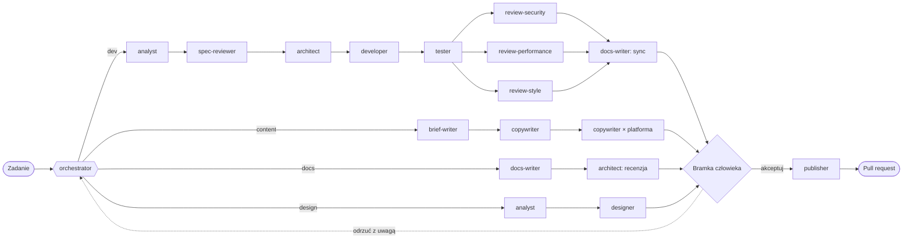
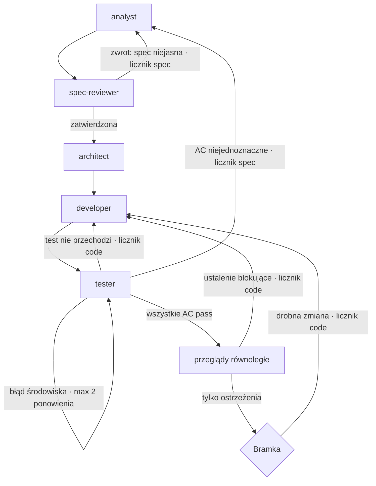

# Orkiestracja agentów: dokumentacja stacku

[English](ORCHESTRATION.md) | Polski

Opis 14 agentów z katalogu `agents/`, tego jak się łączą, z jakich skilli
korzystają i jak wpięte są pamięć, Ponytail, zasady Karpathy'ego i monitor.
Wersja wizualna: [agent-chain.html](agent-chain.html).

## 1. Agenci

| Agent | Pipeline | Rola | Narzędzia | Zapis |
|---|---|---|---|---|
| `orchestrator` | wszystkie | klasyfikuje, planuje, deleguje, liczy próby, prowadzi stan i pamięć, zatrzymuje na bramce | wszystkie (dziedziczone) | tylko `runs/` i `memory/` |
| `analyst` | dev, design | wymagania i kryteria akceptacji | Read, Grep, Glob, Skill | nie |
| `spec-reviewer` | dev | zatwierdza spec albo zwraca z pytaniami | Read, Grep, Glob, Skill | nie |
| `architect` | dev, docs | projekt techniczny i plan; recenzja dokumentacji | Read, Grep, Glob, Skill | nie |
| `developer` | dev | kod test-first, poprawki | Read, Grep, Glob, Edit, Write, Bash, Skill | kod |
| `tester` | dev | weryfikacja per AC z dowodem | Read, Grep, Glob, Bash, Edit, Write, Skill | tylko testy |
| `review-security` | dev | przegląd bezpieczeństwa | Read, Grep, Glob, Skill | nie |
| `review-performance` | dev | przegląd wydajności | Read, Grep, Glob, Skill | nie |
| `review-style` | dev | konwencje, prostota, zakres | Read, Grep, Glob, Skill | nie |
| `designer` | design | flow, makiety, tokeny, handoff | Read, Grep, Glob, Edit, Write, Skill | tylko `runs/<id>/design/` |
| `brief-writer` | content | brief: cel, odbiorca, przekaz | Read, Grep, Glob, Skill | nie |
| `copywriter` | content | tekst główny i adaptacje per platforma | Read, Grep, Glob, Skill | nie |
| `docs-writer` | docs, dev | nowy dokument (docs) oraz aktualizacja dokumentacji po zmianie (dev, tryb `sync`) | Read, Grep, Glob, Edit, Write, Skill | tylko dokumentacja |
| `publisher` | wszystkie | gałąź, commit, PR po akceptacji | Read, Grep, Glob, Bash, Skill | git |

## 2. Format uniwersalny

Jeden plik na agenta, ta sama treść dla obu narzędzi: `<nazwa>.agent.md`.

```yaml
---
name: review-security
description: jedno zdanie, kiedy używać
tools: [Read, Grep, Glob, Skill]
---
```

Dlaczego to działa w obu:

- **Rozszerzenie `.agent.md`** kończy się na `.md`, więc Claude Code ładuje plik
  z `.claude/agents/`, a Copilot z `.github/agents/`. Copilot CLI czyta też
  `.claude/agents/`, więc wystarczy jeden katalog.
- **Nazwy narzędzi w konwencji Claude** (`Read`, `Grep`, `Glob`, `Edit`,
  `Write`, `Bash`) są w Copilocie oficjalnymi aliasami `read`, `search`,
  `edit`, `execute`. Nierozpoznane nazwy Copilot ignoruje.
- **Brak pola `model`.** Agent dziedziczy model sesji w obu narzędziach.
  Identyfikatory modeli różnią się między hostami, więc wpisanie jednego
  zepsułoby drugi. Jeśli chcesz tańszy model dla recenzentów, dodaj pojedynczy
  string per host (Copilot CLI odrzuca tablicę w `model`).
- **Tylko pola wspólne.** Bez `skills`, `hooks`, `handoffs`, `mcp-servers`.
  Skille są wskazane w treści agenta, nie we frontmatterze.
- **Orchestrator nie ma listy `tools`**, bo potrzebuje narzędzi pamięci (MCP)
  i delegowania, których nazwy różnią się między hostami. Jego ograniczenia
  wynikają z treści: nie pisze kodu, nie publikuje.

Instalacja po przeniesieniu:

| Host | Katalog | Uruchomienie |
|---|---|---|
| Claude Code | `.claude/agents/` lub `~/.claude/agents/` | `claude --agent orchestrator` |
| Copilot CLI | `.github/agents/`, `.claude/agents/` lub `~/.copilot/agents/` | `copilot --agent orchestrator` |
| Copilot w VS Code | `.github/agents/` | wybór `orchestrator` w selektorze agentów |

## 3. Pipeline'y



| Pipeline | Kiedy | Etapy |
|---|---|---|
| dev | zmiana kodu | analyst → spec-reviewer → architect → developer → tester → 3 przeglądy równolegle → docs-writer (sync) → bramka → publisher |
| content | tekst dla odbiorców | brief-writer → copywriter → copywriter per platforma (równolegle) → bramka → publisher |
| docs | opis istniejącego | docs-writer → architect (recenzja) → bramka → publisher |
| design | „design", makieta, wireframe, UI/UX, redesign, `/design` | analyst → designer → bramka → publisher |

Zaakceptowany design nie uruchamia sam pipeline'u dev. Orchestrator proponuje
to na bramce i startuje nowy przebieg dopiero po Twojej zgodzie, z designem
jako wejściem.

### Dokumentacja idzie razem ze zmianą

Zmiana nie trafia na bramkę, dopóki dokumentacja opisuje stare zachowanie. W
pipeline dev, po czystych testach i przeglądach, orchestrator uruchamia
`docs-writer` w trybie `sync` z diffem i specyfikacją. Agent szuka miejsc w
dokumentacji, które zmiana czyni nieaktualnymi (README, katalog docs, notatki
architektoniczne, diagramy, changelog), i poprawia tylko je. Jeśli nic nie
wymaga zmiany, odpowiada `DOCS_AFFECTED: none` z listą przeszukanych miejsc.

Zaktualizowane dokumenty trafiają do tego samego PR co kod, a raport na bramce
je wymienia. Gdy późniejsza poprawka znów zmienia kod, sync jest powtarzany.
Ta sama reguła dotyczy samej orkiestracji: gdy `factory` dodaje lub zmienia
agenta, skill albo pipeline, ten dokument i mapa są aktualizowane w tym samym
przebiegu.

### Pętle w pipeline dev



| Co się stało | Dokąd wraca | Licznik |
|---|---|---|
| Spec niejasna | analyst | `spec`, max 3 |
| Test nie przechodzi | developer | `code`, max 3 |
| Ustalenie blokujące z przeglądu | developer | `code`, max 3 |
| Ostrzeżenie z przeglądu | raport na bramce | brak |
| Błąd środowiska | ponowienie kroku | bez licznika, max 2 |
| Poprawka content, docs lub design | agent-autor | `revision`, max 3 |

Po wyczerpaniu licznika etap przechodzi w `waiting_human`, a orchestrator
oddaje raport: cel, co zrobiono, wynik każdej próby, ostatni stan, otwarte
pytanie.

## 4. Kontrakt między agentami

Wzorowany na Superpowers (subagent-driven-development):

- **Brief** od orchestratora to cały kontekst agenta: id przebiegu, etap, numer
  próby, cel i sposób weryfikacji, ścieżki wejść, AC, co jest poza zakresem.
- **Status** w ostatniej wiadomości: `DONE`, `DONE_WITH_CONCERNS`,
  `NEEDS_CONTEXT`, `BLOCKED`. `NEEDS_CONTEXT` nie zużywa próby.
- **Raport to twierdzenie, nie dowód.** Orchestrator i tester sprawdzają
  dowody (wynik testu, diff), zanim etap dostanie `ok`.
- **Agenci robocze nie delegują.** Tylko orchestrator uruchamia agentów.
- **Recenzenci są niezależni:** dostają diff, spec i AC, nigdy raport ani
  rozumowanie developera. Są tylko do odczytu, poprawki robi developer.
- **`ERROR_CLASS`** (`implementation`, `spec_unclear`, `environment`) decyduje,
  dokąd wraca przebieg.

## 5. Stan i bramka

`runs/<run-id>/state.json` jest jedynym źródłem prawdy. Zapisuje tylko
orchestrator; wyniki etapów trafiają do `runs/<run-id>/<etap>.md`. Pełny
schemat jest w [wersji angielskiej](ORCHESTRATION.md#5-state-and-gate) i w
pliku `agents/orchestrator.agent.md`.

Bramka jest przed publikacją w każdym pipeline:

| Decyzja | Skutek |
|---|---|
| Akceptuj | wpis w `decisions` (`by: human`), potem publisher |
| Odrzuć z uwagą | orchestrator wybiera etap i ponawia |
| Drobna zmiana | wraca do autora na liczniku `code` lub `revision` |

Publisher sam czyta `state.json` i bez wpisu akceptacji zwraca `BLOCKED`. Nie
pushuje na gałąź domyślną, nie robi force-push, nie scala PR.

## 6. Skille

Agent ładuje skill, gdy pasuje do kroku. Gdy skilla nie ma, używa domyślnej
checklisty wpisanej w swój plik i zgłasza brak w polu `SKILLS_MISSING`. Dzięki
temu agenci są generyczni, a wiedza o projekcie (stack, konwencje) mieszka w
skillach.

**Skille ogólne (w tym repozytorium, w `skills/`, instalowane razem z agentami):**

| Skill | Używa |
|---|---|
| `task-classification`, `findings-merge`, `retrospective`, `factory` | orchestrator |
| `ac-format` | analyst |
| `spec-checklist` | spec-reviewer |
| `test-strategy` | tester |
| `security-checklist` | developer, review-security |
| `performance-checklist` | review-performance |
| `style-checklist` | review-style |
| `brief-format` | brief-writer |
| `platform-rules` | copywriter |
| `docs-template` | docs-writer |
| `commit-conventions`, `pr-template` | publisher |

**Skille projektowe (w repozytorium konkretnego projektu):** `stack-and-style`
(architect, developer, tester, recenzenci, docs-writer), `architecture-patterns`
(architect) i `design-system` (designer). Opisują jeden projekt, więc nie należą
do tego repozytorium. Skill projektowy o tej samej nazwie co ogólny ma w tym
projekcie pierwszeństwo.

**Skille zewnętrzne (instalowane jako pluginy, nie są tu kopiowane):**

| Źródło | Skille | Używa |
|---|---|---|
| multica-ai/andrej-karpathy-skills | `karpathy-guidelines` | orchestrator, analyst, spec-reviewer, architect, developer |
| obra/superpowers | `brainstorming` | analyst, brief-writer |
| | `writing-plans` | architect |
| | `test-driven-development`, `systematic-debugging` | developer, tester |
| | `receiving-code-review` | developer |
| | `verification-before-completion` | developer, tester |
| | `subagent-driven-development`, `dispatching-parallel-agents`, `requesting-code-review` | orchestrator |
| | `finishing-a-development-branch` | publisher |
| anthropics/skills | `frontend-design`, `web-artifacts-builder`, `canvas-design`, `theme-factory`, `brand-guidelines` | designer |
| | `brand-guidelines` | brief-writer, copywriter |
| | `internal-comms`, `doc-coauthoring` | copywriter, docs-writer |
| | `webapp-testing` | tester |
| DietrichGebert/ponytail | `ponytail` | architect, developer, designer |
| | `ponytail-review` | review-style |
| thedotmack/claude-mem | `mem-search` | orchestrator |

## 7. Co z którego rozwiązania

**Zasady Karpathy'ego.** Orchestrator stosuje cztery reguły na poziomie
delegowania: pomyśl przed delegowaniem (jawne założenia, jedno pytanie zamiast
cichego wyboru), najkrótszy pipeline, zakres chirurgiczny w każdym briefie, cel
weryfikowalny zamiast polecenia. Agenci, którzy analizują i decydują (analyst,
spec-reviewer, architect), oraz developer ładują ten sam skill do własnej pracy.

**Superpowers.** Kontrakt z sekcji 4, test-first u developera, dowód przed
werdyktem u testera, plan w małych zadaniach u architekta.

**Ponytail.** Drabina „najmniejszej kompletnej zmiany" u developera,
architekta i designera: czy to w ogóle potrzebne, czy już jest w kodzie,
biblioteka standardowa, zainstalowana zależność, jedna linia, dopiero potem
nowy kod. Nigdy nie tnie walidacji, obsługi błędów, bezpieczeństwa ani
dostępności. Skróty oznaczane komentarzem `shortcut:` trafiają do opisu PR.
`review-style` używa `ponytail-review`.

**Pamięć: zapis po każdym przebiegu.** Pamięć ma dwie warstwy i pisze do niej
tylko orchestrator.

Warstwa plikowa działa na każdym hoście. Po każdym przebiegu (opublikowanym,
odrzuconym lub eskalowanym) orchestrator zapisuje `memory/runs/<run-id>.md` i
dopisuje linię do `memory/INDEX.md`. Zapis ma mniej niż stronę i zawiera:
prośbę i wynik, decyzje z powodami (w tym Twoje z bramki), co się zapętliło i
co w końcu zadziałało, odrzucone podejścia, poznane konwencje projektu,
brakujące skille i kandydatów z retrospektywy. To wnioski, nie log; log jest w
`state.json`. Na starcie kolejnego przebiegu orchestrator czyta indeks i
otwiera tylko pasujące zapisy. Pliki pamięci nie wchodzą do PR przebiegu.

**claude-mem (pamięć przeszukiwalna, gdy zainstalowana).**

| Moment | Działanie |
|---|---|
| start przebiegu | przypomnienie w trzech krokach: `search` → `timeline` → `get_observations`; wcześniejsze decyzje, odrzucone podejścia, uwagi z bramek, powtarzające się ustalenia |
| w trakcie | do briefów trafia tylko kilka istotnych linii; nic z rozumowania developera nie idzie do recenzentów |
| bramka, eskalacja, koniec | świadoma notatka (`save_memory`): decyzja człowieka z powodem, przyczyna eskalacji, kandydaci z retrospektywy |

Pamięć jest doradcza: `state.json` i bieżące polecenie mają pierwszeństwo.
Brak pamięci nie zatrzymuje przebiegu. Retrospektywa używa pamięci do liczenia
„trzech powtórzeń" między przebiegami.

**Claude Code Agent Monitor (podgląd).** Działa przez hooki hosta, więc nie
wymaga niczego w agentach poza czytelnymi przebiegami: orchestrator zawsze
deleguje do nazwanych agentów i nazywa każde wywołanie
`[<run-id>] <agent> #<próba>`. W monitorze widać drzewo orchestrator → agenci,
narzędzia, tokeny i koszt.

## 8. Instalacja i synchronizacja

Instalacja agentów i skilli dla wszystkich projektów:

```bash
scripts/install.sh
```

Skrypt kopiuje `agents/*.agent.md` i każdy folder `skills/<nazwa>/` do
`~/.claude/` i `~/.copilot/` (do ich folderów `agents/` i `skills/`) i niczego
innego tam nie rusza. `--dry-run` pokazuje, co
by się zmieniło.

Przeniesienie zmian z folderu użytkownika z powrotem do repozytorium:

```bash
scripts/sync-back.sh
```

Skrypt porównuje folder użytkownika z `agents/` i `skills/`, tworzy gałąź
`sync/<znacznik-czasu>` i commituje to, co się zmieniło. `--add NAZWA` i
`--add-skill NAZWA` dodają agenta lub skill, którego repozytorium jeszcze nie
śledzi. `--push`
dodatkowo wypycha gałąź i otwiera pull request. Przed commitem skanuje
zmienione pliki pod kątem ścieżek domowych, adresów e-mail i formatów kluczy;
jeśli coś znajdzie, zatrzymuje się. Uruchamiaj go z aktualnej gałęzi domyślnej.

Zależności w Claude Code:

```
/plugin marketplace add forrestchang/andrej-karpathy-skills
/plugin install andrej-karpathy-skills@karpathy-skills
/plugin install superpowers@claude-plugins-official
/plugin marketplace add anthropics/skills
/plugin install example-skills@anthropic-agent-skills
/plugin marketplace add DietrichGebert/ponytail
/plugin install ponytail@ponytail
```

Copilot CLI:

```
copilot plugin marketplace add obra/superpowers-marketplace
copilot plugin install superpowers@superpowers-marketplace
copilot plugin marketplace add DietrichGebert/ponytail
copilot plugin install ponytail@ponytail
```

Pamięć i monitor:

```
npx claude-mem install
git clone https://github.com/hoangsonww/Claude-Code-Agent-Monitor.git
cd Claude-Code-Agent-Monitor && npm run setup && npm run dev
```

Monitor działa pod `http://localhost:5173` i przy pierwszym uruchomieniu
proponuje instalację hooków.

## 9. Ograniczenia i rzeczy do sprawdzenia

- **Monitor nie obsługuje Copilota.** Według README widzi sesje Claude Code,
  Cursor i Codex. Przebiegi w Copilocie nie pojawią się w panelu.
- **Monitor nie jest bramką.** Pokazuje sesje, nie czyta `state.json`. Decyzję
  podajesz orchestratorowi w rozmowie.
- **claude-mem w Copilot CLI tylko wyszukuje.** Sesje Copilota nie są
  nagrywane, więc pamięć przeszukiwalna rośnie z pracy w Claude Code. Warstwa
  plikowa w `memory/` działa wszędzie. Instalator prosi o
  logowanie i proponuje płatny okres próbny; da się to pominąć flagą
  `--provider` lub zmienną `CLAUDE_MEM_ONLINE_OPTIN=false`.
- **Skille w Copilocie.** Nazwa `Skill` na liście `tools` jest nazwą Claude
  Code. Trzeba sprawdzić, czy agent Copilota z zawężoną listą narzędzi nadal
  ładuje skille; jeśli nie, dopisz nazwę narzędzia skilli Copilota.
- **VS Code.** Format `.agent.md` w `.github/agents/` jest potwierdzony w
  dokumentacji GitHuba i Copilot CLI, jeszcze nie testowany w VS Code.
  `install.sh` nie obejmuje agentów użytkownika dla VS Code.
- **Nazwy skilli z pluginów** mogą mieć prefiks (np. `superpowers:brainstorming`).
  Agenci podają nazwę bez prefiksu; host dopasowuje po nazwie i opisie.
- Frontmattery przechodzą `claude plugin validate`. Pełny przebieg nie był
  jeszcze wykonany; przed użyciem załaduj każdego agenta w CLI i w VS Code.

## 10. Decyzje projektowe

| Decyzja | Powód |
|---|---|
| Jeden plik zamiast osobnych frontmatterów | Copilot przyjmuje nazwy narzędzi Claude jako aliasy i czyta `.claude/agents/` |
| `developer` ma `Bash` | test-first wymaga uruchamiania testów |
| `tester` ma `Edit`/`Write` | pisze brakujące testy per AC; tylko pliki testów |
| Licznik `revision` | poprawki content, docs i design nie są błędem kodu |
| `docs-writer` ma `Edit`/`Write` i etap `sync` w dev | dokumentacja ma się aktualizować razem ze zmianą; tylko pliki dokumentacji |
| Zapis przebiegu w `memory/` | dokument na przyszłość po każdym przebiegu, niezależny od hosta |
| Brak stacku w agentach | wiedza o projekcie należy do skilla `stack-and-style` |
